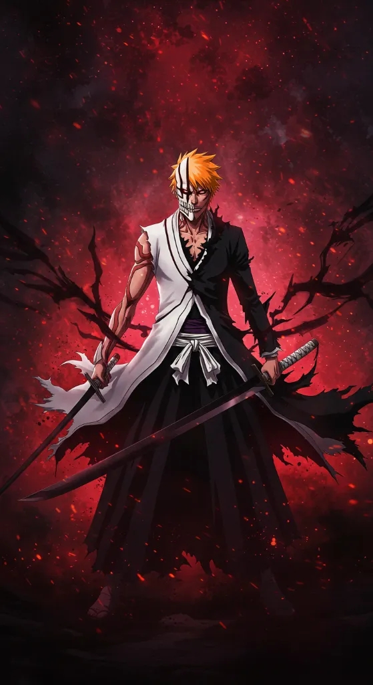

# Anime Fan Test

**How well do you really know your favourite characters? Prove it.**

A static, no-backend quiz site. Pick a character from the roster, hit **Start Test**, answer 5 tough questions, then share your result card or challenge a friend.

Characters: Itachi Uchiha, Kakashi Hatake, Goku, Satoru Gojo, Ichigo Kurosaki (25 questions total).

## Features

- Roster UI with a per-character theme, animated background effects, and portrait frame
- 5 hard, multiple-choice questions per character (lore, abilities, relationships, trivia)
- Options are shuffled on every attempt, with a "Did you know?" fact after each answer
- Keyboard support: `1`-`4` to answer, `Enter` for next, `←` `→` to switch character
- Per-character level: Mastered (5/5), Fan (4/5), Casual (3/5), Newbie (2 or less)
- Final result with an overall rank, downloadable result card (PNG) and native share on mobile
- "Challenge a Friend" link: your friend opens it, takes the test, and sees a head-to-head comparison
- Progress is saved in the browser (localStorage)
- Reduced-motion support; cursor effects are desktop-only




## Project structure

```
.
├── index.html     # everything: UI, styles, questions, logic
├── images/        # character portraits
│   ├── itachi.jpg
│   ├── kakashi.jpg
│   ├── goku.jpg
│   ├── gojo.jpg
│   └── ichigo.webp
└── README.md
```

## Run locally

Open `index.html` in a browser, or serve it (recommended, since result-card download and sharing need a proper origin):

```bash
python -m http.server 8000
# open http://localhost:8000
```

## Deploy

It is a plain static site, so any static host works.

- **Netlify:** drag and drop the folder contents, or connect the GitHub repo with an empty build command and `/` as the publish directory.
- **GitHub Pages:** Settings > Pages > Deploy from a branch > `main` / `(root)`.

Upload the files **inside** the folder (`index.html` and `images/`), not the parent folder, so `index.html` ends up at the repo root.

## Images

Portraits are loaded from `images/<id>.<ext>`. Supported extensions: `jpg`, `jpeg`, `png`, `webp`. If a file is missing, a placeholder is shown.

File names are case-sensitive on most hosts, so keep them lowercase: `itachi`, `kakashi`, `goku`, `gojo`, `ichigo`.

## Editing questions

Questions live in `index.html` in the `QZ` object, keyed by character id. Each question is:

```js
["Question text", "Correct answer", ["Wrong 1", "Wrong 2", "Wrong 3"], "Did-you-know fact"]
```

Keep every question to exactly one correct answer and three plausible distractors. Please verify facts against the source material before adding or changing a question.

To add a character, add an entry to the roster data (copy an existing one as a template), add a matching key to `QZ` with 5 questions, and drop `images/<id>.jpg` in place. Note that the 5 current characters have their own background effects; a new character may only get the default theme.

## Known limitations

- **No global leaderboard.** There is no backend, so only friend-vs-friend comparison is possible.
- **Challenge links are signed, not secure.** A checksum in the link stops casual edits of the score (an edited link shows "not verified"), but anyone who reads the source can forge one. Fine for friendly challenges, not for competitions.
- **Link previews are generic.** WhatsApp, Discord, etc. show the same preview for every link; the personalised card is shared separately as an image.
- Result-card download works best on the deployed https link.

## Disclaimer

Non-commercial fan project. All characters, names and artwork belong to their respective owners. This project is not affiliated with or endorsed by any rights holder.